<div align="center">

# 🚗 CAN Vehicle Monitor & Reverse Safety System

**Three LPC2129 nodes. One CAN bus. Temperature, indicators and reverse-obstacle alerts working together.**


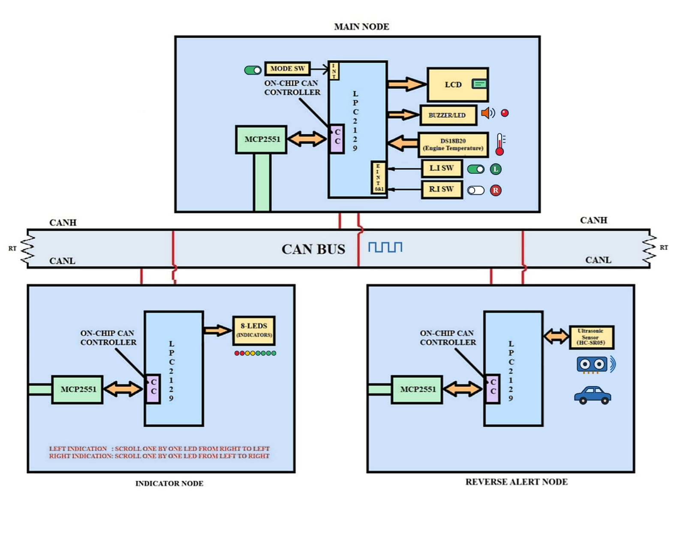

</div>

> [!NOTE]
> **Educational prototype.** This is not production automotive safety equipment and has not been represented as automotive-certified or safety-validated software.

---

## 📑 Table of Contents

1. [At a Glance](#-at-a-glance)
2. [Features](#-features)
3. [System Architecture](#-system-architecture)
4. [CAN Protocol](#-can-protocol)
5. [Node Breakdown](#-node-breakdown)
6. [Hardware & Tools](#-hardware--tools)
7. [Pin Maps](#-pin-maps)
8. [Sensors in Detail](#-sensors-in-detail)
9. [Operating Sequence](#-operating-sequence)
10. [Repository Layout](#-repository-layout)
11. [Build & Flash](#-build--flash)
12. [Prototype Gallery](#-prototype-gallery)
13. [Testing Checklist](#-testing-checklist)
14. [Limitations & Safety Notes](#-limitations--safety-notes)
15. [Roadmap](#-roadmap)

---

## ⚡ At a Glance

| | |
|---|---|
| **Nodes** | 3 × LPC2129 (Main, Indicator, Reverse Alert) |
| **Bus speed** | 125 kbit/s (set in `Common/can_defines.h`) |
| **Transceiver** | MCP2551 or compatible, one per node |
| **Temperature sensor** | DS18B20 (1-Wire) on the Main Node |
| **Distance sensor** | HC-SR05-compatible ultrasonic module |
| **Alert threshold** | 20 cm (software constant, 3-sample average) |
| **CAN IDs used** | `0x101`, `0x102`, `0x201` |

**In one sentence per node:**

- 🧠 **Main Node** reads temperature, shows status on the LCD, handles three interrupt switches, sends commands and sounds the reverse buzzer.
- 💡 **Indicator Node** receives left/right/off commands and runs an eight-LED sweep.
- 📡 **Reverse Alert Node** measures distance in reverse mode and reports distance plus alert status.

## ✨ Features

- 🌡️ Engine-temperature monitoring with a DS18B20 digital sensor
- 🔗 CAN communication between independent embedded nodes
- ⏱️ Interrupt-driven left, right and mode switches
- 🔄 Forward / reverse mode toggling
- 📏 Ultrasonic obstacle detection while in reverse
- 🖥️ LCD status display with buzzer/LED warning output
- 🚦 Eight-LED indicator animation
- 🧩 Modular Embedded C drivers (CAN, LCD, DS18B20, ultrasonic, interrupts, buzzer)

---

## 🏗️ System Architecture

### Bus topology

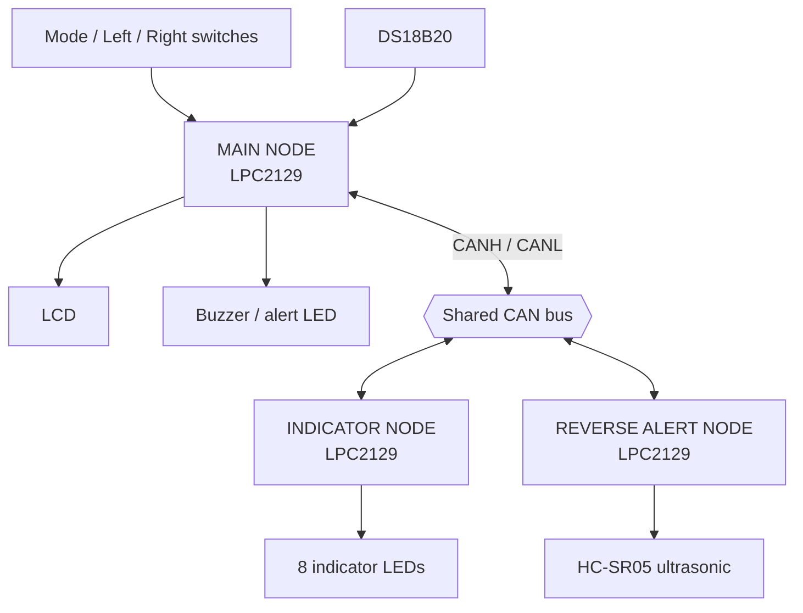

Each node connects its on-chip CAN controller to the bus through a CAN transceiver such as the MCP2551. Terminate the **two ends** of the bus only; intermediate nodes should not each get their own 120 Ω resistor.

### Visual guide

<table>
<tr>
<td width="50%" align="center">
<b>Physical CAN bus & node interfaces</b><br><br>
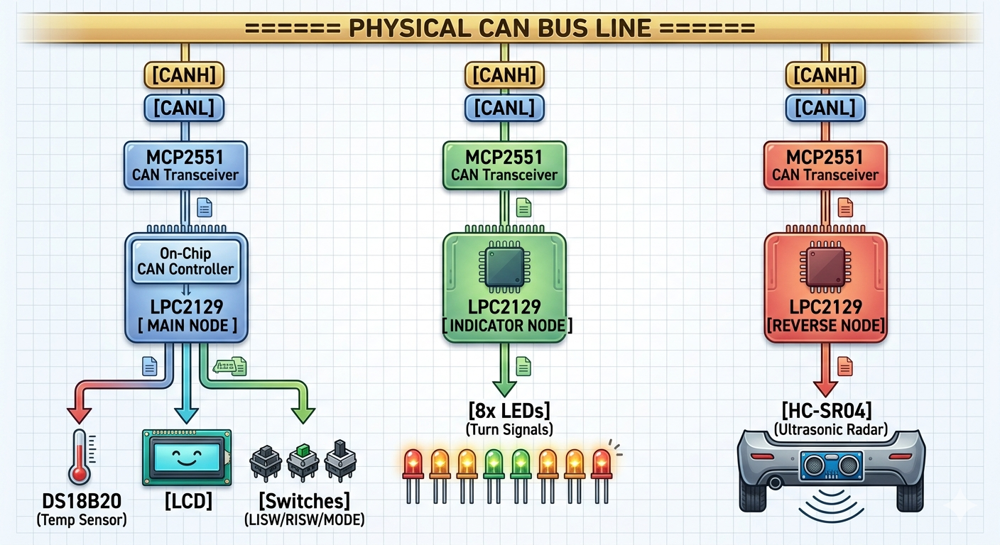
</td>
<td width="50%" align="center">
<b>Development & integration workflow</b><br><br>
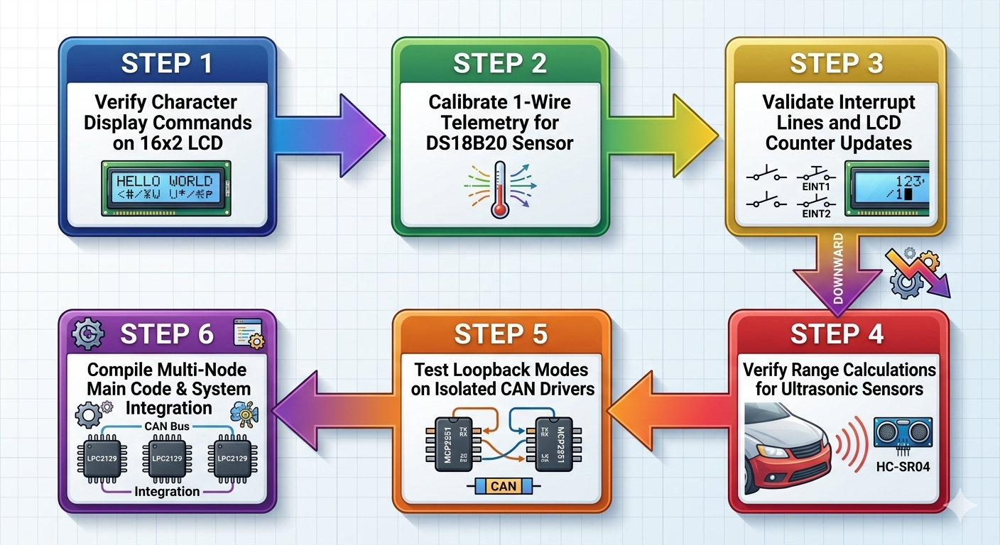
</td>
</tr>
<tr>
<td align="center">
<b>Reverse-alert node concept</b><br><br>
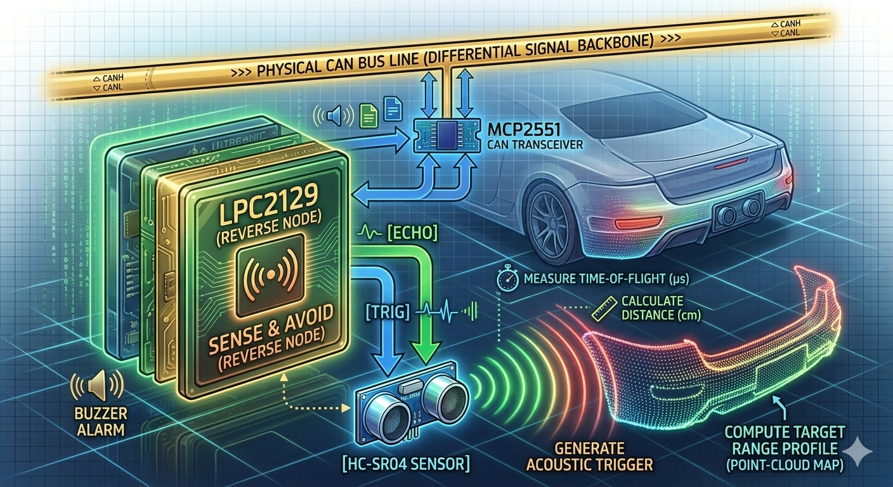
</td>
<td align="center">
<b>Indicator-node concept</b><br><br>
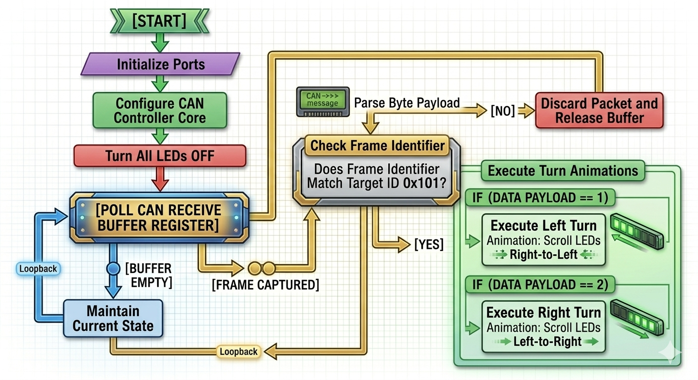
</td>
</tr>
<tr>
<td colspan="2" align="center">
<b>Main-node software flow</b><br><br>
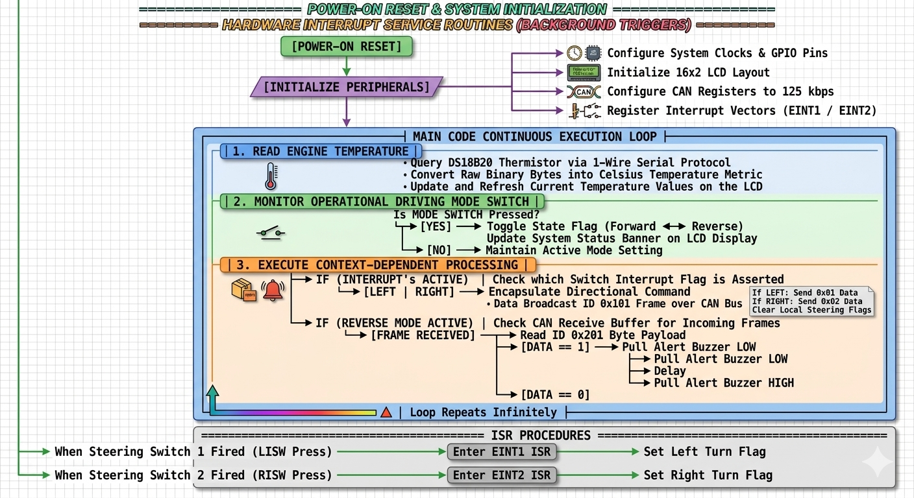
</td>
</tr>
</table>

- The **workflow** image shows a staged plan: verify LCD → bring up DS18B20 1-Wire → validate interrupts/LCD → test ultrasonic range → test CAN loopback/communication → integrate the three node images. It is a development plan, not proof that every stage passed.
- The **Reverse Alert** image shows echo measurement, distance calculation, threshold comparison and CAN reporting.
- The **Indicator** image shows the command frame being mapped to the eight-LED animation.
- The **Main-node** image shows initialization, the monitoring loop, switch-event handling, CAN transmit and received-status checks.

> [!IMPORTANT]
> **Diagram accuracy.** These images are explanatory. Where labels differ from the source or hardware , trust the board markings, datasheets, pin configuration and compiled firmware. The diagrams do not verify wiring or test results.

---

## 📨 CAN Protocol

All three message types use standard identifiers. IDs name a **message type**, not a physical address; each node filters on the IDs it cares about.

| ID | Direction | `Data1` | `Data2` | Meaning |
|:---:|---|---|---|---|
| `0x101` | Main → Indicator | ASCII `'L'`, `'R'` or `'S'` | unused | Left / right / indicators off |
| `0x102` | Main → Reverse Alert | `0` forward, `1` reverse | unused | Current vehicle mode |
| `0x201` | Reverse Alert → Main | Distance (cm) | `0` clear, `1` obstacle | Distance and alert status |

**Message triggers**

| ID | Triggered by | Receiver does |
|:---:|---|---|
| `0x101` | Left/right switch event or stop command | Updates the LED pattern |
| `0x102` | Mode switch change | Enables/disables reverse measurements |
| `0x201` | End of a measurement cycle | Updates the reverse-warning decision |

**Payload notes**

- `Data1` and `Data2` are single bytes (0–255). If the protocol is extended, define explicit scaling plus codes for invalid, timeout and stale data.
- A timeout or missing frame must **never** be read as a measured 0 cm distance.
- Temperature is handled locally on the Main Node; no CAN temperature message exists in the current source.
- All nodes must agree on bit rate (125 kbit/s), frame format, ID meaning and payload layout.

---

## 🧩 Node Breakdown

<details open>
<summary><b>🧠 Node 1: Main Node</b>, central monitoring and command</summary>

1. Initializes the LCD, DS18B20 interface, CAN controller, buzzer output and external interrupts.
2. Reads DS18B20 over 1-Wire and shows the result on the LCD.
3. Uses three falling-edge external interrupts: mode, left indicator, right indicator.
4. Mode switch toggles `0 = Forward` / `1 = Reverse` and sends it in `0x102`.
5. Indicator events are encoded as `L`, `R` or `S` and sent in `0x101`.
6. Receives `0x201`: distance in `Data1`, alert flag in `Data2`.
7. In reverse mode, activates the warning output when the alert flag reports an obstacle inside range.

ISRs should only record the event and set a flag; CAN transmission and LCD updates belong in the main loop.
</details>

<details>
<summary><b>💡 Node 2: Indicator Node</b>, LED sequencing from CAN commands</summary>

1. Initializes CAN1 and configures `P0.0`–`P0.7` as LED outputs.
2. Polls CAN receive status and reads available frames.
3. Processes only ID `0x101`.
4. Reads `Data1` as `L`, `R` or `S`.
5. `L` sweeps LEDs 0 → 7, `R` sweeps 7 → 0, `S` turns all LEDs off.

The source logic assumes **active-low LEDs** (low = on). Confirm against your board wiring.
</details>

<details>
<summary><b>📡 Node 3: Reverse Alert Node</b>, distance measurement and alert reporting</summary>

1. Initializes CAN1 and the ultrasonic Trigger/Echo pins.
2. Listens for `0x102` (vehicle mode).
3. Measures only when mode is reverse (`1`).
4. Averages three readings to damp unstable samples.
5. Compares the average with the **20 cm** threshold: below 20 cm → `alert = 1`, else `alert = 0`.
6. Sends `0x201` with distance in `Data1` and alert in `Data2`.
7. Waits roughly 100 ms, then repeats.

The driver uses a timeout so a missing Echo never blocks forever. Treat a timeout as an invalid measurement and confirm the application handles the returned value safely.
</details>

---

## 🔧 Hardware & Tools

| Component | Qty | Role |
|---|:---:|---|
| LPC2129 | 3 | Main, Indicator, Reverse Alert nodes |
| MCP2551 (or compatible) | 1 per node | CAN controller ↔ CANH/CANL interface |
| DS18B20 | 1 | Temperature on Main Node |
| HC-SR05-compatible ultrasonic module | 1 | Reverse distance |
| Character LCD | 1 | Main Node display |
| LEDs | 8 + warning LED(s) | Indicator animation and warning |
| Buzzer | 1 | Audible reverse warning |
| Switches | 3 | Mode, left, right |
| USB-to-UART adapter / programmer | as needed | Flashing and debugging |
| CAN wiring + termination resistors | as needed | Shared bus |

**Software:** Embedded C, Keil µVision with a compatible ARM toolchain, Flash Magic (if the board bootloader supports it), LPC21xx headers plus LPC2129 startup/linker configuration.

---

## 📍 Pin Maps

> [!WARNING]
> These maps come from the GPIO/peripheral definitions in the source, **not** from a verified schematic. Check them against your LPC2129 package, board schematic and pin-mux table before powering up.

<details>
<summary><b>Main Node</b></summary>

| Function | Pin | Direction | Notes |
|---|---|---|---|
| LCD D0–D7 | `P0.8`–`P0.15` | Out | 8-bit data bus |
| LCD RS | `P0.16` | Out | Command (0) / data (1) |
| LCD EN | `P0.17` | Out | Enable strobe |
| LCD RW | `P0.18` | Out | Low = write. Tie low in hardware if the LCD is never read and the driver allows it |
| DS18B20 DQ | `P0.19` | Bidirectional | 1-Wire; needs pull-up |
| Buzzer | `P0.20` | Out | Initialized low, low = active; confirm driver polarity and drive circuit |
| Mode switch | `P0.1` / `EINT0` | In / IRQ | Falling edge |
| Left switch | `P0.3` / `EINT1` | In / IRQ | Falling edge |
| Right switch | `P0.7` / `EINT2` | In / IRQ | Falling edge |
| CAN1 RX | `P0.25` / `RD1` | Peripheral in | From transceiver RXD |
| CAN1 TX | `P0.24` / `TD1` | Peripheral out | Verify PINSEL in driver and datasheet |
</details>

<details>
<summary><b>Indicator Node</b></summary>

| Function | Pin | Direction | Notes |
|---|---|---|---|
| LED 0–7 | `P0.0`–`P0.7` | Out | Active-low per source logic |
| CAN1 RX | `P0.25` / `RD1` | Peripheral in | Via transceiver |
| CAN1 TX | `P0.24` / `TD1` | Peripheral out | Verify peripheral selection |
</details>

<details>
<summary><b>Reverse Alert Node</b></summary>

| Function | Pin | Direction | Notes |
|---|---|---|---|
| Ultrasonic Trigger | `P0.20` | Out | Trigger pulse to sensor |
| Ultrasonic Echo | `P0.19` | In | Echo pulse width measured |
| CAN1 RX | `P0.25` / `RD1` | Peripheral in | Receives mode messages |
| CAN1 TX | `P0.24` / `TD1` | Peripheral out | Sends distance/alert |
</details>

### CAN bus wiring

- LPC2129 CAN TX → transceiver `TXD`; transceiver `RXD` → LPC2129 CAN RX.
- Join all `CANH` lines together and all `CANL` lines together.
- Share a common ground between nodes.
- Terminate at the two bus ends only.
- Follow the transceiver maker's supply and decoupling guidance.

> [!IMPORTANT]
> The source explicitly configures CAN1 RX on `P0.25`. Inspect the CAN driver and the LPC2129 datasheet to confirm CAN1 TX (`P0.24`) is also selected. A comment alone does not prove the pin mux is set.

---

## 🔬 Sensors in Detail

### 🌡️ DS18B20: engine temperature

A digital sensor on a single **1-Wire** line, so no ADC conversion is needed.

**Read sequence**

1. Controller issues a reset pulse.
2. Sensor answers with a presence pulse.
3. Controller sends the ROM command (single device) and the convert-temperature command.
4. After the conversion time, the scratchpad temperature registers are read.
5. Firmware converts the signed raw value to a temperature for the LCD.

**Wiring**

- `VDD` → a supply allowed by the datasheet and board.
- `GND` → common ground.
- `DQ` → Main Node `P0.19`, with a pull-up (commonly ~4.7 kΩ) to the logic supply. Check the value against sensor, cable length and board.
- Keep the data line within safe GPIO levels: do not pull a 3.3 V MCU input up to 5 V unless the pin is documented 5 V tolerant.

### 📏 HC-SR05-compatible ultrasonic: reverse distance

1. The driver pulls Trigger low briefly, then sends a high pulse of about 10 µs.
2. The module emits an ultrasonic burst and holds Echo high for the round-trip time.
3. Timer0 measures the Echo pulse width.
4. Distance is estimated with:

   ```text
   distance_cm ≈ echo_time_us / 58
   ```

   This assumes room-temperature sound speed and typical HC-SR05-style timing. Verify against the module datasheet and timer calibration.

**Pins (Reverse Alert Node):** Trigger `P0.20`, Echo `P0.19`.
**Threshold:** alert when the 3-sample average is under **20 cm**. This is a software constant, not a universal safe stopping distance.

> [!CAUTION]
> Many HC-SR05-style modules drive Echo at about 5 V. Check the exact module's output level and the LPC2129 input tolerance, and use a level shifter or resistor divider if needed. Never exceed the pin's absolute maximum rating.

---

## 🔁 Operating Sequence

This reflects the intended behavior documented from the source; exact timing depends on clock and timer configuration.

| Stage | What happens |
|---|---|
| **1. Power-on** | Configure clock and pin functions → init LCD and outputs → init CAN at 125 kbit/s → configure Main Node interrupts → init node-specific sensors |
| **2. Main loop** | Request and read DS18B20 → convert and show temperature (avoid full-screen clear/repaint) → process recorded switch events → transmit CAN commands on state change → check received reverse-alert frames |
| **3. Indicator Node** | Receive frames → ignore anything but `0x101` → decode `L`/`R`/`S` → run sweep or turn LEDs off |
| **4. Reverse Alert Node** | Receive `0x102` → if reverse, take readings → average three → compare with 20 cm → send `0x201` |
| **5. Main Node alert** | Accept `0x201` → confirm reverse mode and alert flag → drive the buzzer per its polarity and circuit |

**ISR rule:** acknowledge the event, set a flag, return. Keep LCD updates, delays, ultrasonic timing and CAN processing out of ISRs, and verify the real code follows this before claiming it does.

---

## 📂 Repository Layout

```text
CAN-Based-Vehicle-Monitoring-System/
├── README.md
├── images/                   # Diagrams and prototype photos used in this README
├── Common/
│   ├── can.c / can.h
│   ├── can_defines.h
│   ├── delay.c / delay.h
│   ├── defines.h
│   └── types.h
├── Main_Node/
│   ├── main_node.c
│   ├── interrupt.c
│   ├── buzzer.c / buzzer.h
│   ├── lcd.c / lcd.h / lcd_defines.h
│   └── ds18b20.c / ds18b20.h
├── Indicator_Node/
│   └── indicator_node.c
├── Reverse_Alert_Node/
│   ├── reverse_node.c
│   └── ultrasonic.c
├── Hardware/
│   └── BLOCKDIAGRAM.jpeg     # Add the actual diagram
└── Documentation/            # Add test logs, screenshots, wiring notes
```

---

## 🛠️ Build & Flash

The repository has Embedded C sources but **no complete Keil project/workspace or confirmed linker/startup configuration**. Build each node as its own firmware image.

1. **Create a project** in Keil µVision for the exact LPC2129 device.
2. **Add sources** per node:
   - Main: `main_node.c`, LCD, DS18B20, interrupt, buzzer, plus common CAN/delay.
   - Indicator: `indicator_node.c`, CAN driver, delay.
   - Reverse Alert: `reverse_node.c`, `ultrasonic.c`, CAN driver.
3. **Check configuration:** startup file, clock, memory layout, compiler version, CAN pin multiplexing.
4. **Compile** and clear all warnings/errors; make sure no node's sources leak into another build.
5. **Flash** each board with its supported method (Flash Magic only if the bootloader and serial wiring allow).
6. **Test** each node alone, then join the bus and test the full system.

> Don't call the firmware build-verified until all three images compile with the real toolchain.

---

## 📸 Prototype Gallery

Diagrams explain the design; these photos show the assembled boards and LCD states from the demonstration.

<table>
<tr>
<td align="center" width="50%">
<b>1. Startup screen</b><br>
<sub>Project title on the LCD</sub><br><br>
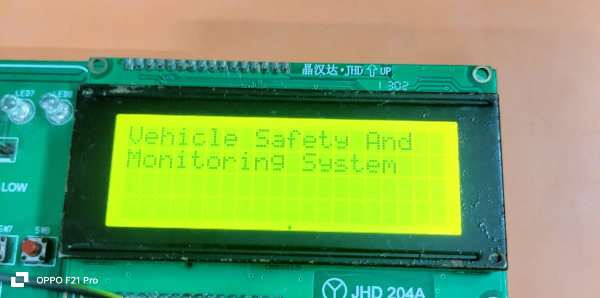
</td>
<td align="center" width="50%">
<b>2. Complete hardware setup</b><br>
<sub>Multiple LPC2129 boards on jumper wires; LCD and ultrasonic sensor visible</sub><br><br>
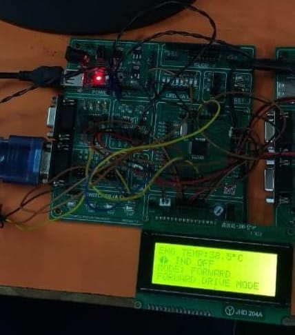
</td>
</tr>
<tr>
<td align="center">
<b>3. Forward mode</b><br>
<sub>Temperature, indicator status and forward state</sub><br><br>
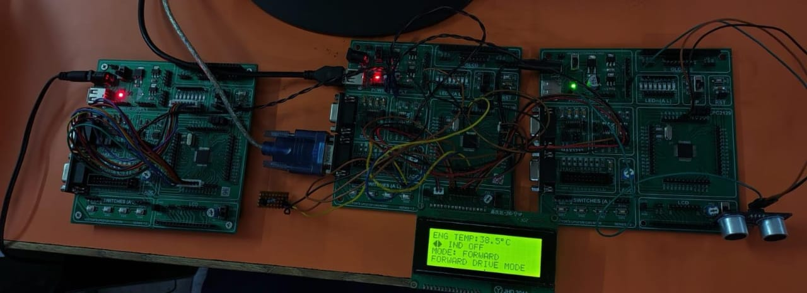
</td>
<td align="center">
<b>4. Reverse mode and obstacle alert</b><br>
<sub>Reverse state with distance/alert status</sub><br><br>
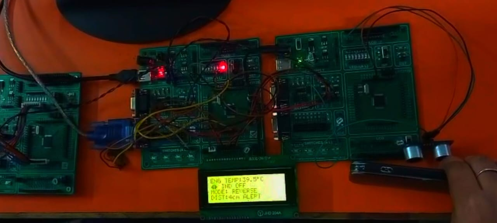
</td>
</tr>
<tr>
<td align="center">
<b>5. Left indicator</b><br>
<sub>Hardware during left-indicator demonstration</sub><br><br>
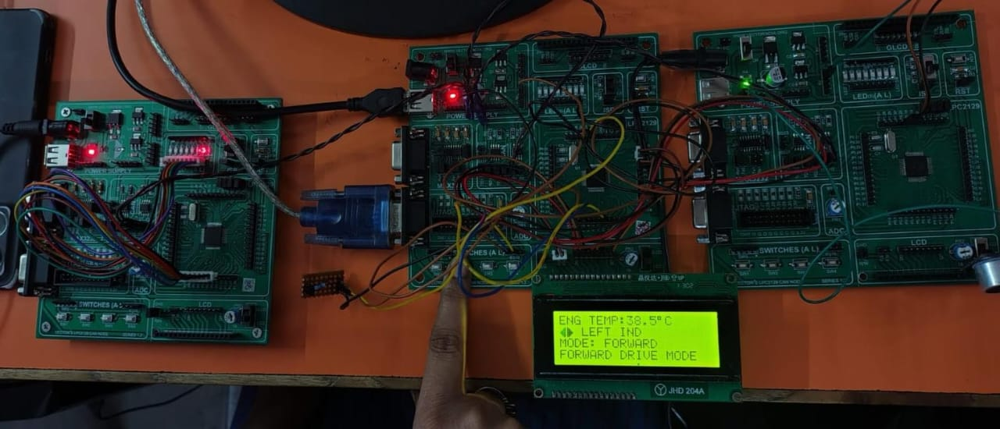
</td>
<td align="center">
<b>6. Right indicator</b><br>
<sub>Hardware during right-indicator demonstration</sub><br><br>
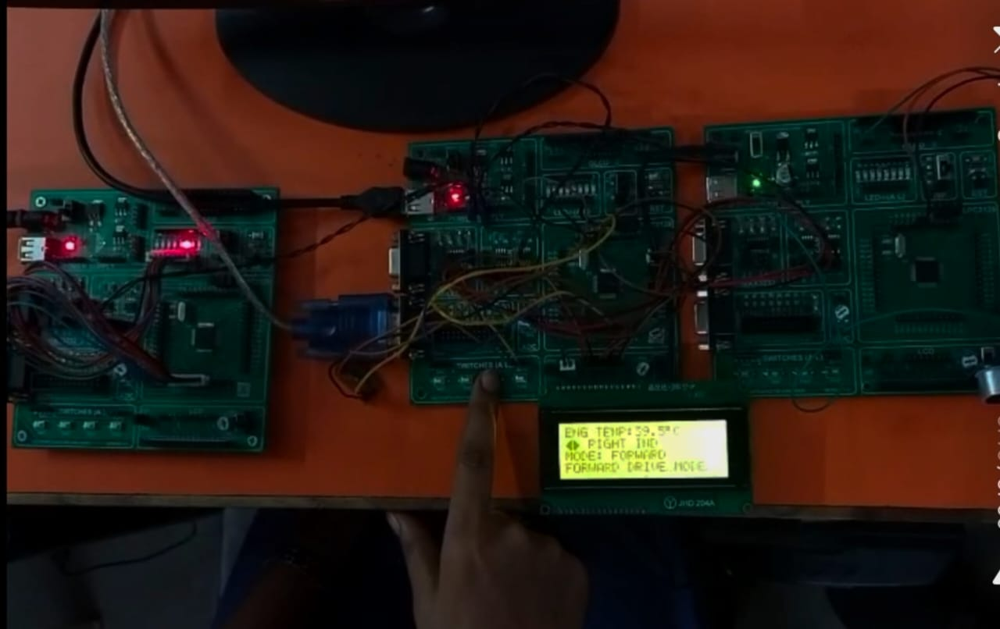
</td>
</tr>
</table>

**What the photos show**

- The LCD displays the project title and operating information.
- Temperature appears in °C, with readings around 38–40 °C.
- Forward and reverse states are both displayed.
- Indicator states are demonstrated on the physical setup.
- Reverse mode shows a distance or alert status from the ultrasonic path.

> [!NOTE]
> These are qualitative visual observations, not calibrated measurements. They do not prove sensor accuracy, error-free CAN operation, response time or automotive safety. Before making quantitative claims, log known target distances, displayed distances, CAN reception, alert on/off points and any failures in a results table. Label simulation results as simulation and hardware results as hardware.

---

## ✅ Testing Checklist

- [ ] LCD initialization and string/character display
- [ ] DS18B20 presence detection and reading checked against a reference
- [ ] Mode switch toggles forward/reverse
- [ ] Left/right interrupts send the expected CAN commands
- [ ] Indicator Node receives `0x101` and sweeps in the correct direction
- [ ] Reverse Node receives `0x102` and measures only in reverse
- [ ] Distances tested on both sides of the 20 cm threshold
- [ ] Main Node receives `0x201` and drives the warning correctly
- [ ] CAN checked for wiring, termination, common ground, bit rate and error conditions
- [ ] Missing/invalid Echo does not produce a false close-obstacle alert
- [ ] Behavior verified after power cycling and with sensors disconnected

Add photos, LCD captures, measured results and a demo video only from working hardware, and don't use placeholder images as proof of completed tests.

---

## ⚠️ Limitations & Safety Notes

- Not suitable as the sole safety system in a real vehicle.
- A fixed distance threshold ignores speed, braking distance, sensor blind zones and environment.
- Ultrasonic readings can be unreliable on angled, soft, narrow or irregular obstacles.
- Add handling for sensor failure, stale CAN data, bus-off/error states, switch bounce and timeouts before claiming stronger reliability.
- Verify pin mappings, voltage levels, pull-ups, transceiver wiring and termination against real hardware and datasheets.
- Byte-sized payloads limit the transmitted distance range; define scaling and validity codes when extending the protocol.

## 🗺️ Roadmap

- [ ] CAN timeout and error-state handling with a safe response to stale sensor data
- [ ] Sensor-fault detection and an explicit invalid-measurement status
- [ ] Better switch debounce and indicator state handling
- [ ] Temperature threshold warnings and, if needed, a documented CAN temperature message
- [ ] CAN message database/specification and a host-side automated test tool
- [ ] System-level testing, timing measurements and a hardware wiring diagram
- [ ] Data logging or IoT monitoring as a separate extension

---

## 🏁 Conclusion

This project shows modular Embedded C on the LPC2129 and practical integration of CAN messaging, digital temperature sensing, external interrupts, LCD output, LED control and ultrasonic ranging. Its three-node layout makes it a good learning platform for how distributed controllers share commands and sensor status over one bus.
